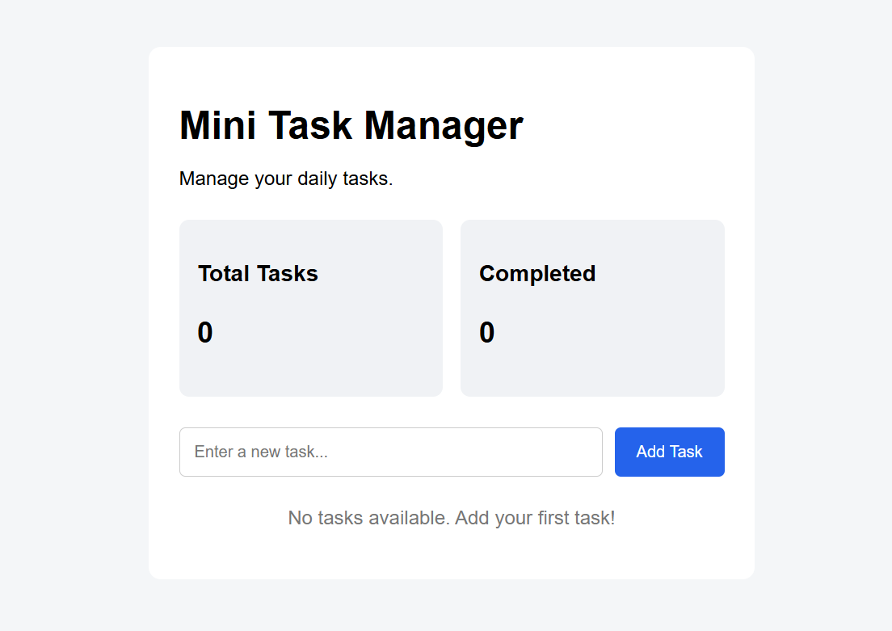

# Mini Task Manager

A simple and interactive task management application built using React. This project is part of my hands-on React learning journey.

## Project Preview



## Features

- Add new tasks
- View all tasks
- Mark tasks as completed
- Delete tasks
- View task statistics

## Tech Stack

- React.js
- JavaScript
- HTML5
- CSS3
- Vite

## Getting Started

Follow these steps to run the project locally.

**1. Clone the repository**

```bash
git clone YOUR_REPOSITORY_URL
```

**2. Navigate to the project folder**

```bash
cd mini-task-manager
```

**3. Install dependencies**

```bash
npm install
```

**4. Start the development server**

```bash
npm run dev
```

Open the local URL displayed in your terminal to view the application.

## What I Learned

- React components and JSX
- Managing state using `useState`
- Handling user events
- Conditional rendering
- Rendering lists using `map()`
- Working with CSS and Flexbox

## Future Improvements

- Save tasks using localStorage
- Add task editing functionality
- Add task filters

---

Built as part of my React learning journey.